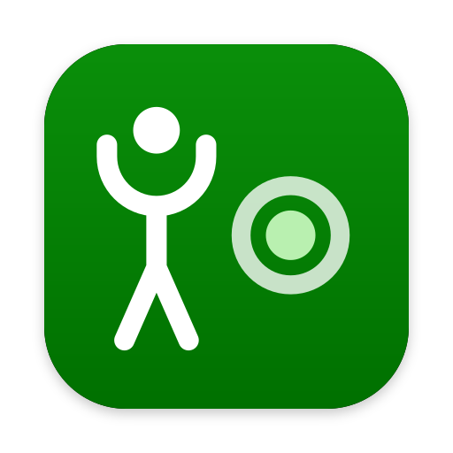
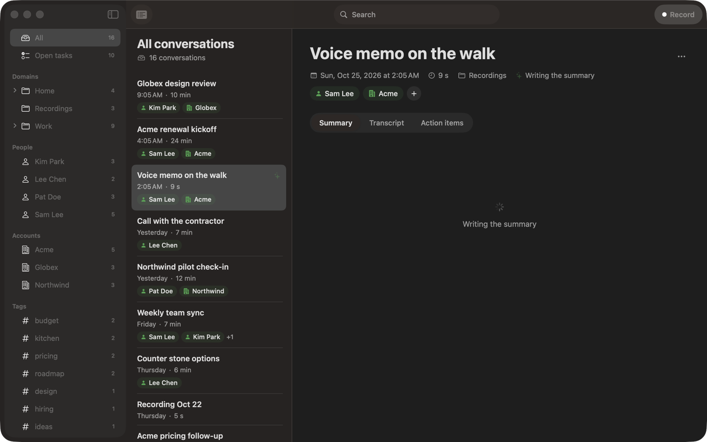

> **Glyph Record is now part of [Glyph Jot](https://github.com/fru-dev3/glyph-jot)** (2026-10-25).
> One Mac app: hold Fn to jot, click Record for meetings, one library for notes, dictations and
> recordings. Download it from [glyph-jot releases](https://github.com/fru-dev3/glyph-jot/releases/latest)
> or see [glyph.fru.dev/jot](https://glyph.fru.dev/jot). This repository is archived and kept as it was.

<p align="center"></p>

<h1 align="center">Glyph Record</h1>

<p align="center"><i>Formerly Memosa.</i></p>

<p align="center"><b>Record meetings and conversations on your Mac. Nothing leaves it.</b></p>

<p align="center">
  <a href="https://github.com/fru-dev3/glyph-record/releases/latest/download/Glyph-Record.dmg">Download for Mac</a> ·
  <a href="https://glyph.fru.dev/record">glyph.fru.dev/record</a> ·
  <a href="#build-from-source">Build from source</a>
</p>

<p align="center"></p>

Glyph Record records a meeting, a call or a talk on your Mac: your voice through the
microphone and, if you like, the Mac's own sound, so the other side of a call is in the
recording too. Apple's on-device speech recognition writes the transcript, and Apple
Intelligence on the Mac writes a summary, the decisions and the action items with their
owners and dates. No account, no cloud, no servers.

Everything lives in a folder of plain files you own (the [vault format](docs/vault-format.md)):
one folder per conversation with its audio, `transcript.json`, `notes.md` and `meta.json`,
plus a Markdown note for each person and account. Edit them by hand, sync them, keep them
in git.

## What it does

- **Records** from the menu bar or the window (Command-R): mic, plus the Mac's sound if you allow it. Pause and resume.
- **Transcribes and summarizes** on the Mac, then suggests who and what the conversation is about. You say yes or no.
- **People, accounts and tags.** Each person and account has a page with every conversation and a note.
- **Open tasks** across every conversation, checked off in place.
- **Search** every transcript (Command-F), **Quick Open** (Command-K), **Copy as Markdown** (Command-Shift-C), **Import Audio** (Command-Shift-I).

## Install

1. [Download Glyph-Record.dmg](https://github.com/fru-dev3/glyph-record/releases/latest/download/Glyph-Record.dmg),
   open it and drag Glyph Record to Applications. It's signed and notarized by Apple.
2. Open it and allow the **Microphone** when asked. To record the other side of calls, allow
   the Mac's sound too when you first turn it on.
3. Click Record. Needs macOS 26; summaries need Apple Intelligence turned on.

## Build from source

You need Xcode 26 and [XcodeGen](https://github.com/yonaskolb/XcodeGen) (`brew install xcodegen`).

```sh
git clone https://github.com/fru-dev3/glyph-record.git
cd glyph-record
xcodegen generate
xcodebuild -project GlyphRecord.xcodeproj -scheme GlyphRecord -configuration Release -derivedDataPath build build
open "build/Build/Products/Release/Glyph Record.app"
```

Tests: `xcodebuild -project GlyphRecord.xcodeproj -scheme GlyphRecord test` for the app, and
`cd Packages/GlyphCore && swift test` for the engine. To try it with a made-up vault:
`python3 RecordTests/make-demo-vault.py /tmp/demo-vault`, then choose that folder in Settings.

## Layout

| Path | What |
|---|---|
| `Record/` | The app (SwiftUI) |
| `RecordTests/` | App logic tests and the demo vault maker |
| `Packages/GlyphCore/` | The engine: vault, recording, transcription, on-device AI ([README](Packages/GlyphCore/README.md)) |
| `docs/vault-format.md` | The file format |

## Versions

- **0.1.0** First release of Glyph Record, the Mac recorder from the Glyph family (formerly Memosa): recording with the Mac's sound, on-device transcripts and summaries, people, accounts, tags and open tasks over a plain-file vault.

## License

MIT, see [LICENSE](LICENSE). Made by [fru.dev](https://fru.dev).
